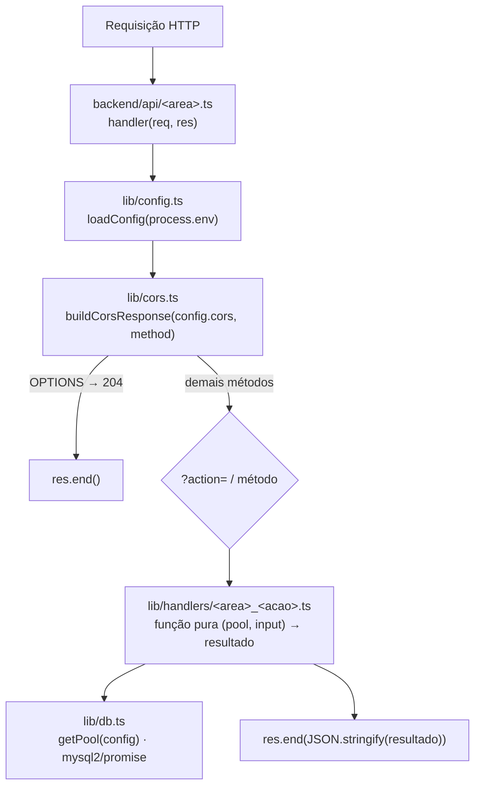
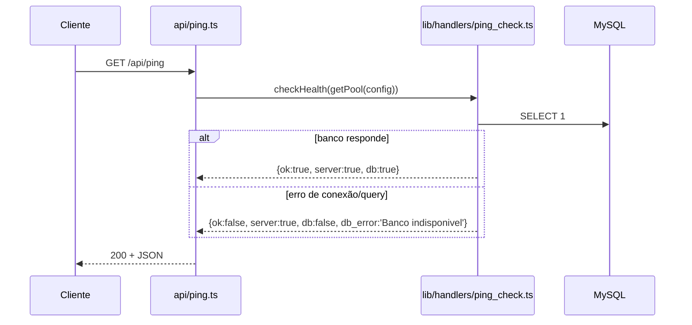

# Módulo: Backend Core (Vercel Functions)

> Esqueleto comum a todos os endpoints de `backend/api/`: config, CORS, pool MySQL e
> healthcheck. Regra de camadas (`agent.md` §5.7): o arquivo em `api/` só faz CORS,
> dispatch e serialização; a lógica de domínio vive em `lib/handlers/*.ts`, testável
> com um `Pool` falso.
>
> `lib/handlers/*.ts` exporta só funções puras (sem `export default handler`): quem fala HTTP é
> sempre o arquivo de `api/`. Os 26 handlers HTTP duplicados que existiam ali (nunca importados)
> foram removidos em 2026-11-07.

---

## Diagrama 1 — Ciclo de uma requisição

## Diagrama 2 — Healthcheck (`/api/ping`)

---

## Limite de Serverless Functions (Vercel Hobby = 12)

- Cada `backend/api/*.ts` vira uma função própria no deploy.
- `backend/.vercelignore` exclui `api/*.test.ts` do deploy.
- Guardrails contam só `*.ts` sem `*.test.ts`: `.github/workflows/ci.yml` (job de limite)
  e `preflight.sh` (passo do backend). Ambos falham acima de 12.
- Para novas operações, preferir uma nova `?action=` num arquivo existente a criar arquivo novo.

## Dívida conhecida

Ainda com lógica de domínio inline em `api/` (violando §5.7), com teste em `api/*.test.ts`:

| Arquivo              | Função inline | Módulo dono      | Observação                 |
|----------------------|---------------|------------------|----------------------------|
| `api/groups_draw.ts` | `runDraw`     | juiz_sorteio     | Toca crypto → skill `007`  |
| `api/reveal.ts`      | `getReveal`   | juiz_sorteio     | Toca tokens → skill `007`  |
| `api/invite.ts`      | `getInvite`   | orquestrador_grupo | Toca tokens → skill `007` |

`checkHealth` já foi extraído para `lib/handlers/ping_check.ts` (2026-11-06).
