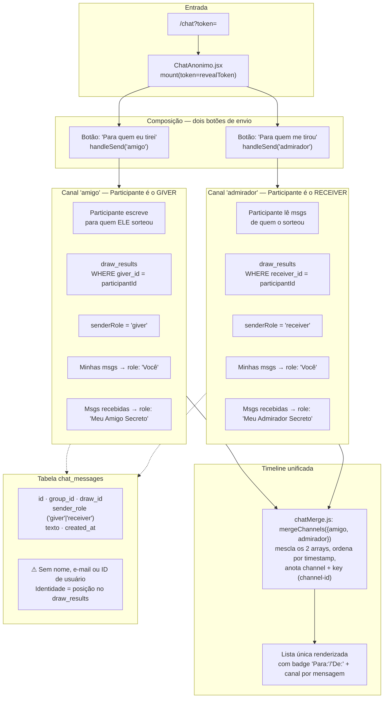
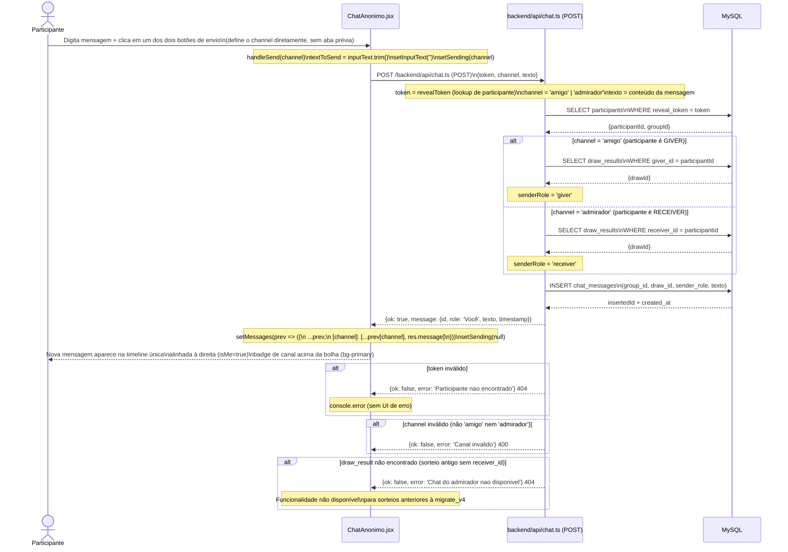
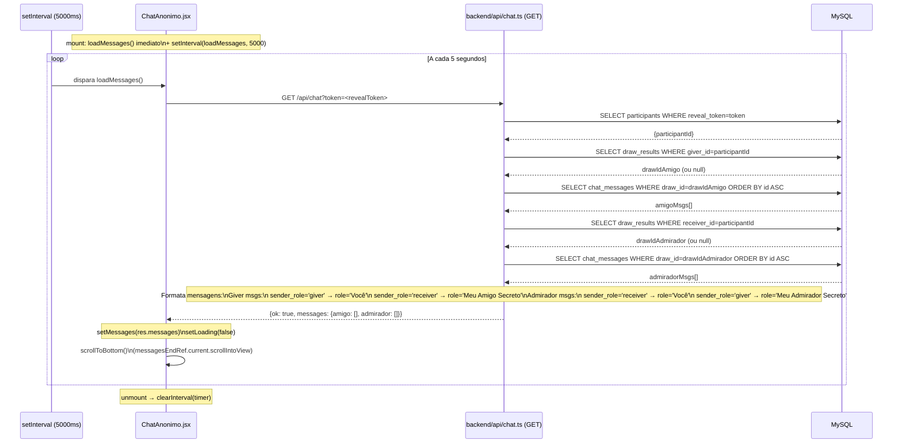
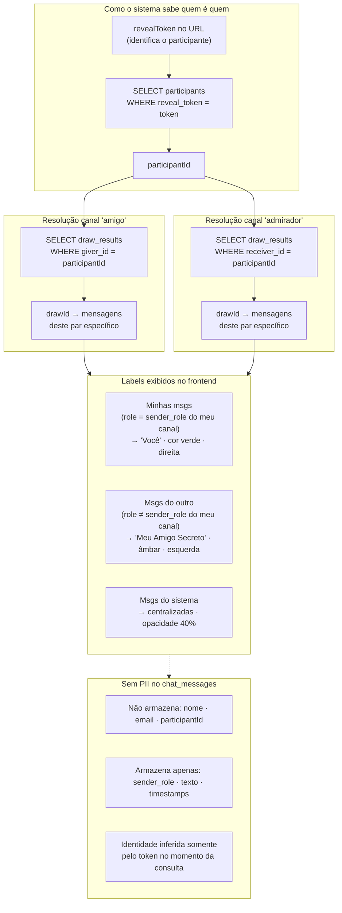
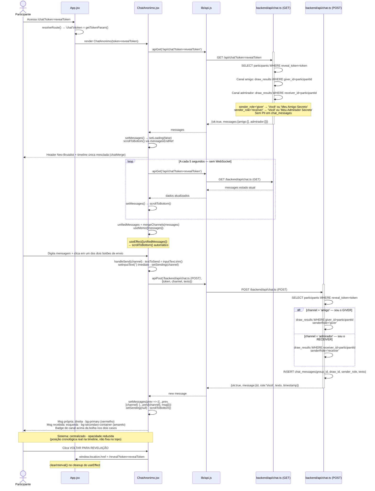

# Módulo: Chat Anônimo (SA-04 · A Sombra)

> **Achado crítico de redesign:** O chat possui **dois canais independentes** por participante,
> não um único. A identidade é mascarada exclusivamente pelo campo `sender_role` na tabela
> `chat_messages` — nenhum PII é armazenado no chat. Desde o redesign de 2026-11-06, a UI não
> separa mais os canais por aba: as mensagens dos dois canais aparecem numa única timeline
> ordenada por tempo, cada uma identificada por um badge de canal + direção (`Para:`/`De:` +
> label dinâmico 'Amigo Secreto'/'Admirador Secreto'). A cor de fundo da bolha continua
> indicando só quem enviou ('Você' vs. o outro), não o canal.

> **Tecnologia:** Polling puro a cada 5 segundos via `setInterval`. Não há WebSocket nem SSE.

---

## Diagrama 1 — Arquitetura de Dois Canais



---

## Diagrama 2 — Fluxo de Envio de Mensagem



---

## Diagrama 3 — Polling e Exibição de Mensagens



---

## Diagrama 4 — Lógica de Mascaramento de Identidade



---

## Regras de Negócio Preservar no Redesign

| Regra | Origem no código | Criticidade |
|---|---|---|
| Dois canais mesclados numa timeline única, ordenada por timestamp | `frontend/src/lib/chatMerge.js` (`mergeChannels`) + dois arrays em `messages` | **Alta** — lógica central |
| Badge de canal + direção por mensagem | `channelLabel`/`channelAccent` em `ChatAnonimo.jsx` | **Alta** — identificação visual do canal |
| Label 'Você' para mensagens próprias | `msg.role === 'Você'` → `isMe = true` | **Alta** — identidade mascarada |
| Dois botões de envio, um por canal | `handleSend('amigo')` / `handleSend('admirador')` | **Alta** — substitui seleção de aba |
| Sistema como primeira mensagem | Injetado em `backend/api/chat.ts (GET)` formatação | **Média** — UX de contexto |
| Polling 5 segundos | `setInterval(loadMessages, 5000)` | **Média** — sem WebSocket |
| Scroll automático ao fundo | `scrollToBottom()` após `setMessages` | **Baixa** — UX |
| Botão voltar para revelação | `window.location.href = /reveal?token=` | **Média** — navegação |
| Entrada desabilitada se texto vazio | `disabled={!inputText.trim()}` | **Baixa** — UX |

---

## Diagrama 5 — Composição do Shell Neo-Brutalist (pós-redesign 2026-06-28)

> **Nota de redesign:** `ChatAnonimo.jsx` não usa mais `TerminalPanel`. Possui
> header sticky e bottom nav próprios com estética Neo-Brutalist. `App.jsx` renderiza
> `ChatAnonimo` diretamente quando `token` está presente na rota `/chat`.



---

## 🔄 Ação Requerida — Obsidian Mirror

```
╔══════════════════════════════════════════════════════╗
║  ⚑  AÇÃO REQUERIDA · MIRROR OBSIDIAN                ║
╠══════════════════════════════════════════════════════╣
║  Módulo: chat_anonimo                                ║
║  Arquivo: docs/modules/chat_anonimo.md               ║
║  Draw.io: docs/arquitetura.drawio (swimlane SA-04)   ║
║                                                      ║
║  Após qualquer alteração em:                         ║
║  ChatAnonimo.jsx · backend/api/chat.ts (GET) · backend/api/chat.ts (POST)      ║
║  Tabelas: chat_messages · draw_results               ║
║                                                      ║
║  1. Atualizar swimlane SA-04 no drawio               ║
║  2. Refletir mudança neste arquivo Mermaid           ║
║  3. Copiar bloco Mermaid atualizado para o vault     ║
║  4. Exportar PNG do drawio para vault                ║
╚══════════════════════════════════════════════════════╝
```
