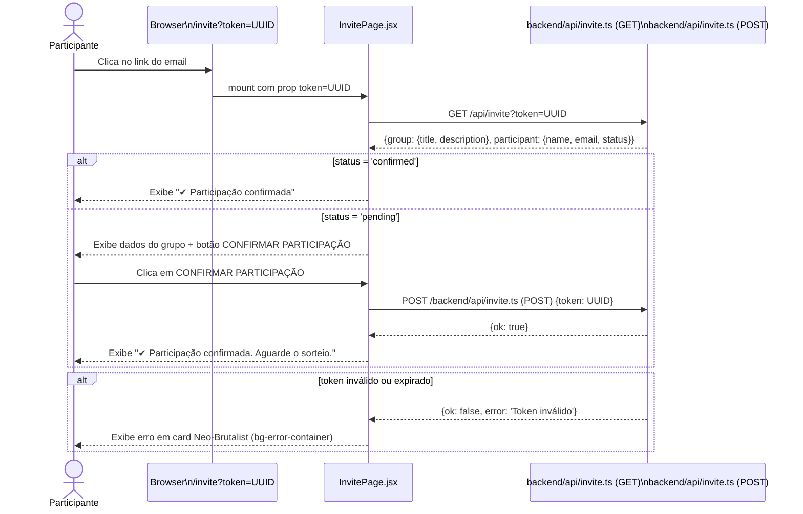
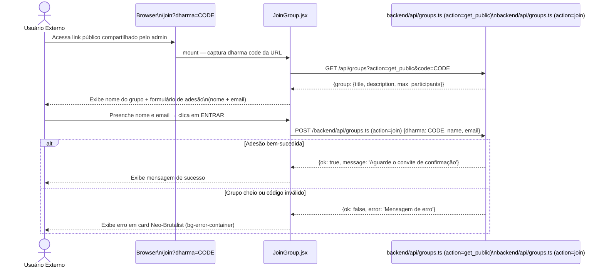

# Módulo: Menu Inicial — Fluxo de Entrada e Self-Invitation

> **Contexto de uso:** Inclua este arquivo em prompts sobre o ponto de entrada da aplicação,
> fluxo de autenticação admin, CTAs do AdminDashboard, e fluxo de convite/adesão de participante.

---

## Diagrama 1 — Roteamento e Entry Point (App.jsx)

```mermaid
flowchart TD
    START([Usuário acessa URL]) --> RESOLVE[resolveRoute\nApp.jsx]

    RESOLVE -->|path = /invite| ROUTE_INVITE[route = 'invite']
    RESOLVE -->|path = /reveal| ROUTE_REVEAL[route = 'reveal']
    RESOLVE -->|path = /join| ROUTE_JOIN[route = 'join']
    RESOLVE -->|path = /chat| ROUTE_CHAT[route = 'chat']
    RESOLVE -->|qualquer outro path| ROUTE_ADMIN[route = 'admin']

    ROUTE_ADMIN --> CHECK_ENV{VITE_API_BASE_URL\nconfigurado?}
    CHECK_ENV -->|NÃO| ERR_ENV["StatusScreen (Neo-Brutalist)\nErro: API não configurada"]
    CHECK_ENV -->|SIM| CHECK_SESSION[apiGet /backend/api/admin.ts (action=me)\nverifica cookie de sessão]

    CHECK_SESSION -->|checking=true| LOADING["StatusScreen (Neo-Brutalist)\nCarregando sessão..."]
    CHECK_SESSION -->|admin presente| DASHBOARD["AdminDashboard.jsx\nlayout próprio Neo-Brutalist"]
    CHECK_SESSION -->|sem sessão| AUTH["AdminAuth.jsx\nlayout próprio Neo-Brutalist"]

    ROUTE_INVITE --> CHECK_TOKEN_I{?token=\npresente?}
    CHECK_TOKEN_I -->|SIM| INVITE_PAGE["InvitePage.jsx\nlayout próprio Neo-Brutalist"]
    CHECK_TOKEN_I -->|NÃO| ERR_TOKEN_I["StatusScreen (Neo-Brutalist)\nErro: Token de convite ausente"]

    ROUTE_REVEAL --> CHECK_TOKEN_R{?token=\npresente?}
    CHECK_TOKEN_R -->|SIM| REVEAL_PAGE["RevealPage.jsx\nlayout próprio Neo-Brutalist"]
    CHECK_TOKEN_R -->|NÃO| ERR_TOKEN_R["StatusScreen (Neo-Brutalist)\nErro: Token de revelação ausente"]

    ROUTE_JOIN --> JOIN_PAGE["JoinGroup.jsx\nlayout próprio Neo-Brutalist"]

    RESOLVE -->|path = /reset-password| ROUTE_RESET[route = 'reset-password']
    ROUTE_RESET --> RESET_PAGE["ResetPassword.jsx\nlayout próprio Neo-Brutalist\n(token via URLSearchParams)"]

    ROUTE_CHAT --> CHECK_TOKEN_C{?token=\npresente?}
    CHECK_TOKEN_C -->|SIM| CHAT_PAGE["ChatAnonimo.jsx\nlayout próprio Neo-Brutalist"]
    CHECK_TOKEN_C -->|NÃO| ERR_TOKEN_C["StatusScreen (Neo-Brutalist)\nErro: Token ausente"]
```

> **StatusScreen** é um componente local definido em `App.jsx` (não é mais um arquivo
> separado) — substitui o antigo `TerminalPanel` para os estados sem rota dedicada.

---

## Diagrama 2 — CTA Flow no AdminDashboard

> Detalhamento completo (estados de view, validação, status de participantes) em
> `docs/modules/orquestrador_grupo.md` Diagrama 1.

```mermaid
flowchart TD
    ADMIN_DASH([AdminDashboard.jsx\nAdmin autenticado]) --> CTA_MENU{Ação do Admin}

    CTA_MENU -->|Criar Grupo| CREATE_GROUP["view='create'\nFormulário inline (título, descrição,\ndraw_date, budget_limit) → backend/api/groups.ts (action=create)"]
    CTA_MENU -->|Selecionar Grupo existente| GROUP_DETAIL[backend/api/groups.ts (action=detail)\nCarrega participantes e status]
    CTA_MENU -->|Enviar Convites| INVITE_FLOW[backend/api/groups.ts (action=invite)\nbackend/lib/mailer.ts dispara emails]
    CTA_MENU -->|Realizar Sorteio| DRAW_FLOW[backend/api/groups_draw.ts\nVer módulo juiz_sorteio.md]
    CTA_MENU -->|Deletar Grupo| DELETE_GROUP[backend/api/groups.ts (action=delete)\nConfirmação obrigatória]
    CTA_MENU -->|Logout| LOGOUT_FLOW[apiPost /backend/api/admin.ts (action=logout)\nsetAdmin null → AdminAuth]

    CREATE_GROUP --> ADD_PARTICIPANTS["view='detail'\nInput nome+email inline\naddPendingParticipant()"]
    ADD_PARTICIPANTS --> INVITE_FLOW

    INVITE_FLOW --> EMAIL_SENT[Email enviado\nLink: /invite?token=UUID]
    EMAIL_SENT --> INVITE_PAGE_ENTRY([Participante acessa /invite?token=UUID])
```

---

## Diagrama 3 — Fluxo de Self-Invitation (InvitePage.jsx)



---

## Diagrama 4 — Fluxo de Adesão Pública (JoinGroup.jsx · Dharma Code)



---

## Layout por Rota (100% Neo-Brutalist — sem CRT)

> **2026-06-29:** Migração completa. Nenhuma rota usa mais TerminalPanel/CRT — o
> componente foi removido do projeto junto com StepIndicator, RetroTyping,
> ThemeContext e themes.js (ver `dependencias_react.md`).

| Situação | Componente principal |
|---|---|
| API não configurada | `StatusScreen` (local em `App.jsx`) |
| Verificando sessão (loading) | `StatusScreen` (local em `App.jsx`) |
| Admin autenticado | AdminDashboard.jsx (full-page) |
| Sem sessão admin | AdminAuth.jsx (full-page) |
| `/invite` com token | InvitePage.jsx (full-page) |
| `/invite` sem token | `StatusScreen` (local em `App.jsx`) |
| `/reveal` com token | RevealPage.jsx (full-page) |
| `/reveal` sem token | `StatusScreen` (local em `App.jsx`) |
| `/chat` com token | ChatAnonimo.jsx (full-page) |
| `/chat` sem token | `StatusScreen` (local em `App.jsx`) |
| `/join` | JoinGroup.jsx (full-page) |
| `/reset-password` | ResetPassword.jsx (full-page, token via URL) |

---

## Pontos de Extensão (Onde Adicionar Features)

| Feature desejada                         | Ponto de inserção                        |
|------------------------------------------|------------------------------------------|
| Nova rota pública                        | `resolveRoute()` em `App.jsx` + novo componente |
| Novo CTA no dashboard                    | `AdminDashboard.jsx` + novo endpoint no backend TS |
| Novo campo no formulário de convite      | `InvitePage.jsx` + `backend/api/invite.ts (POST)`  |
| Nova classe utilitária Neo-Brutalist      | `src/index.css` (`@layer components`)    |
| Página de erro personalizada             | Novo componente + tratamento em `App.jsx`|
