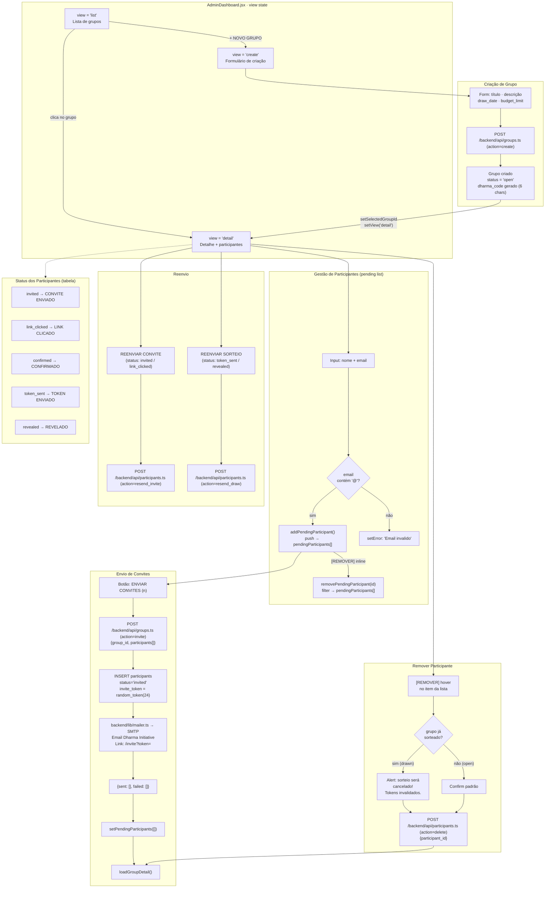
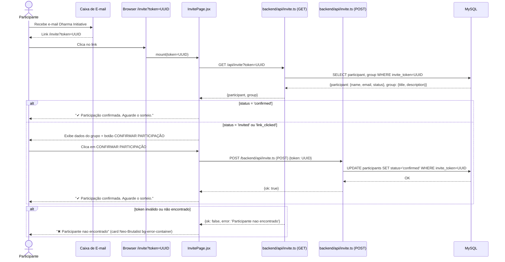
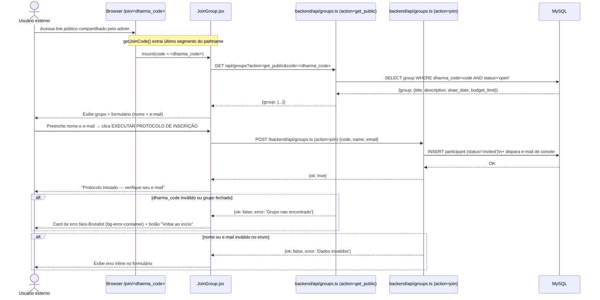
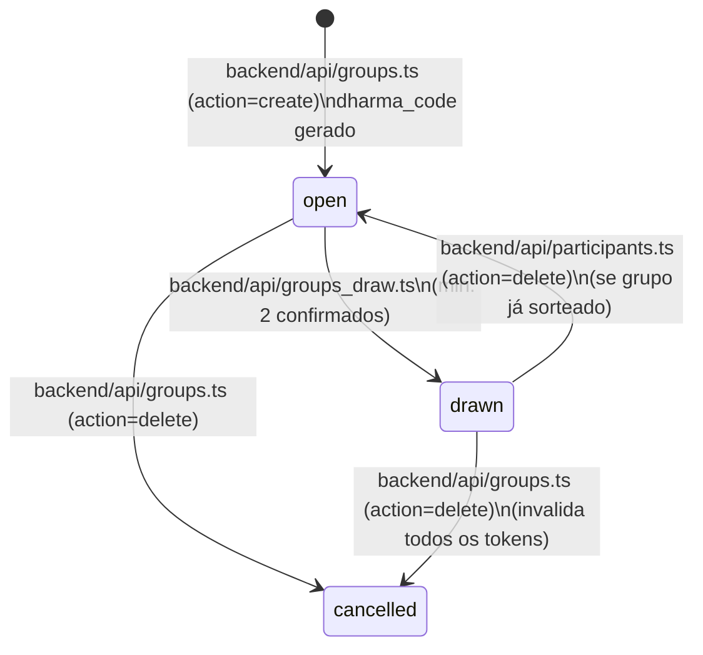

# Módulo: Orquestrador de Grupo (SA-02)

---

## Diagrama 1 — Ciclo de Vida do Grupo e Gestão de Participantes



---

## Diagrama 2 — Fluxo de Confirmação de Convite (InvitePage.jsx)



---

## Diagrama 3 — Auto-Inscrição via Dharma Code (JoinGroup.jsx)



---

## Estados do Grupo (status field)



---

## 🔄 Ação Requerida — Obsidian Mirror

```
╔══════════════════════════════════════════════════════╗
║  ⚑  AÇÃO REQUERIDA · MIRROR OBSIDIAN                ║
╠══════════════════════════════════════════════════════╣
║  Módulo: orquestrador_grupo                          ║
║  Arquivo: docs/modules/orquestrador_grupo.md         ║
║  Draw.io: docs/arquitetura.drawio (swimlane SA-02)   ║
║                                                      ║
║  Após qualquer alteração em:                         ║
║  AdminDashboard.jsx · backend/api/groups.ts · backend/api/invite.ts     ║
║                                                      ║
║  1. Atualizar swimlane SA-02 no drawio               ║
║  2. Refletir mudança neste arquivo Mermaid           ║
║  3. Copiar bloco Mermaid atualizado para o vault     ║
║  4. Exportar PNG do drawio para vault                ║
╚══════════════════════════════════════════════════════╝
```
